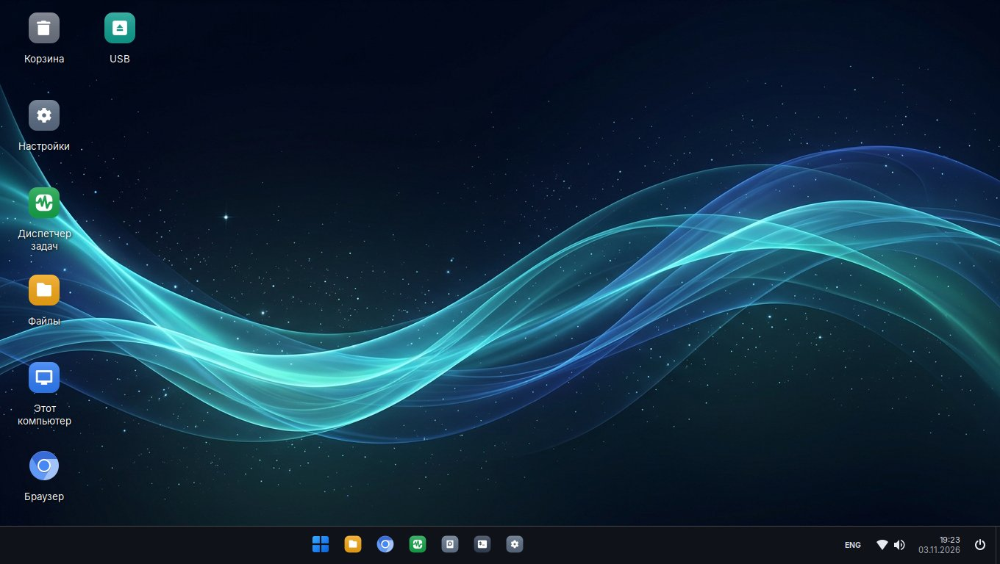
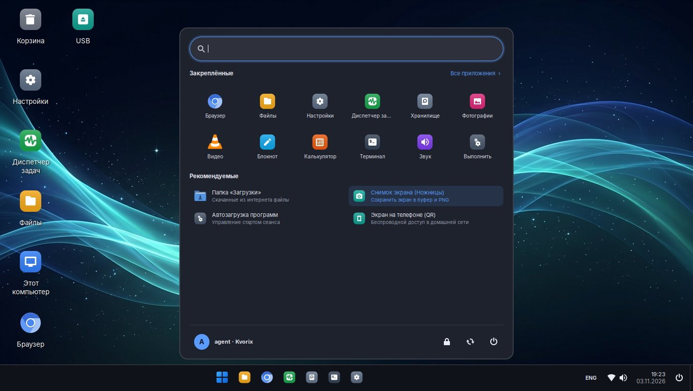
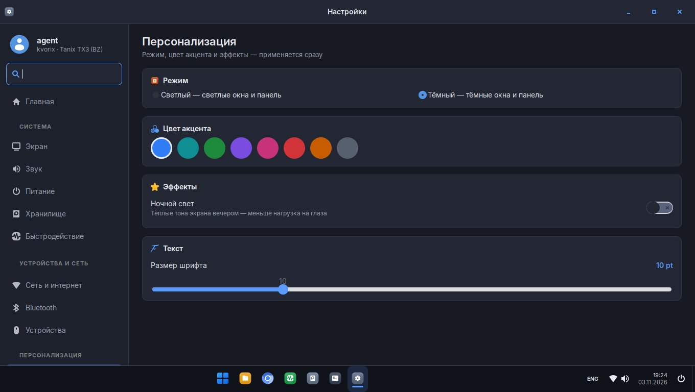

<div align="center">

# Kvorix

[Русский](README.md) · **English** · [中文](README.zh.md)

**A fast desktop computer made from the Tanix TX3 TV box (Amlogic S905X3)**

Armbian (Debian 13 "trixie") · ophub 6.12 kernel · XFCE with a Windows 11-style shell · custom Settings and icons

[](LICENSE)




</div>

## What it is

Kvorix turns a cheap **Tanix TX3** Android box into a quiet home computer: web browser, files, video, printing,
screen sharing to a phone and DPI bypass — all usable without a terminal.

- **Windows 11-style shell:** centered taskbar, Start menu with search and pinned apps,
  Win+E / Win+I / Win+R / Win+P / Win+V / Ctrl+Shift+Esc, window snapping.
- **On-screen keyboard** (Win+Ctrl+O) for mouse and remote control.
- **One icon style everywhere**; newly installed apps get a matching icon automatically.
- **Custom Settings app** laid out like Windows 11, with search across every option.
- **Display without HPD:** the TX3 cannot detect HDMI hot-plug, so the monitor is read via EDID over DDC;
  native mode, HDMI audio and an overscan-fit mode for TVs.
- **Front panel clock 88:88** (FD6551): time, date, temperature, load.
- **Screen sharing to a phone** by QR code (noVNC, home network only).
- **DPI bypass** (zapret) and **Tailscale**.
- **Speed:** CPU up to 2.1 GHz, zram, Panfrost GPU, GPU-accelerated Chromium.
- **Self-healing:** network/service watchdog, Tailscale recovery, `kvorix-health-check`.

| Start | Settings |
|---|---|
|  |  |

## Install

1. Flash the **ophub Armbian** image for S905X3 (Debian trixie, kernel 6.12) to an SD card or USB stick —
   [ophub/amlogic-s9xxx-armbian](https://github.com/ophub/amlogic-s9xxx-armbian/releases) — and boot from it.
2. Create the user **`agent`** during first setup.
3. Install Kvorix:

```bash
git clone https://github.com/NineUPFLOW/kvorix.git
cd kvorix
sudo ./install.sh
sudo reboot
```

`install.sh` installs the packages from `packages.txt`, copies `rootfs/` into `/`, enables the Kvorix services and
creates this box's own SSH keys, VNC password and noVNC token. To build your own image for your boxes, see
[docs/BUILD.md](docs/BUILD.md) (Russian).

## Hardware

Tested on **Tanix TX3 (BZ)**: Amlogic S905X3 (4× Cortex-A55), 2 GB RAM, 16 GB eMMC, Broadcom BCM4330 Wi-Fi/BT,
FD6551 front panel, device tree `meson-sm1-tx3-bz.dtb`. Other S905X3 boxes may work with another dtb.

## Documentation

Detailed docs are in Russian in [`docs/`](docs): installation, building, features, architecture, hardware,
troubleshooting, plus [SECURITY.md](SECURITY.md) and [CHANGELOG.md](CHANGELOG.md).

## License

Kvorix — © 2026 **NineUPFLOW**, licensed under the [GNU GPL v3.0](LICENSE): you may use, study, modify and share it,
keeping the authorship and the same license. Third-party components keep their own licenses — see
[THIRD_PARTY.md](THIRD_PARTY.md).
