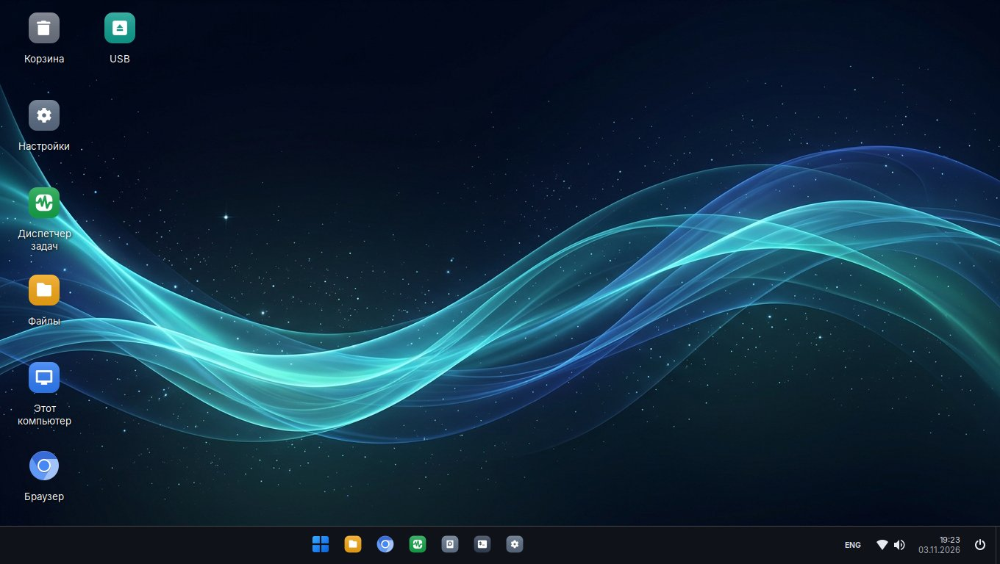
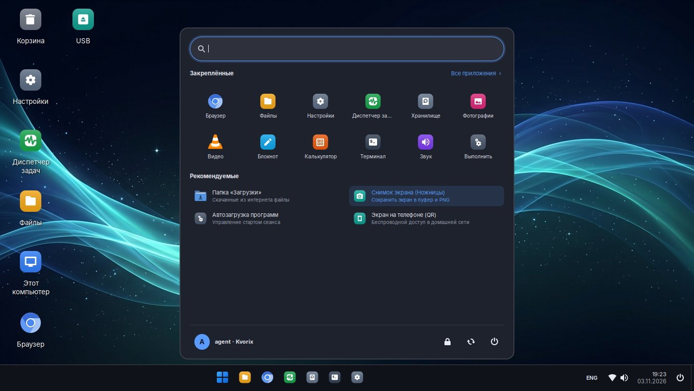
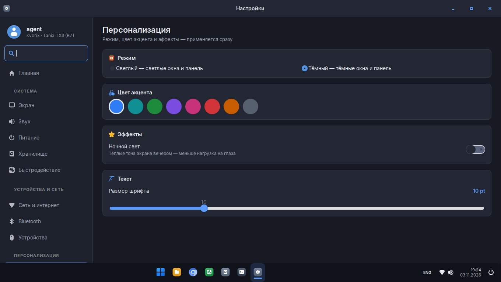

# Kvorix

**Быстрый «настольный компьютер» из ТВ-приставки Tanix TX3 (Amlogic S905X3)**

Armbian (Debian 13 «trixie») · ядро ophub 6.12 · XFCE с оболочкой в стиле Windows 11 · свои Настройки, значки и сервисы

---

## Что это

Kvorix превращает дешёвую Android-приставку **Tanix TX3** в тихий компьютер для дома: браузер, файлы, видео, печать,
показ экрана на телефон, обход блокировок — всё работает «из коробки», без командной строки.

- **Оболочка в стиле Windows 11:** панель задач по центру, меню «Пуск» с поиском и закреплёнными программами,
  Win+E / Win+I / Win+R / Win+P / Win+V / Ctrl+Shift+Esc, прикрепление окон к краям (Win+← / Win+→).
- **Единые значки:** цветной скруглённый квадрат с белым символом — на рабочем столе, в «Пуске», на панели,
  в Проводнике и Настройках. Новые программы получают значок автоматически при установке.
- **Свои «Настройки»** (как в Windows 11): экран, звук, питание, хранилище, быстродействие, сеть, Bluetooth,
  устройства, оформление, обои, время и язык, приложения, автозагрузка, службы, учётные записи, безопасность,
  обновления, доступ ИИ — с поиском по всем параметрам.
- **Экран без HPD:** у TX3 не работает сигнал подключения HDMI — служба сама читает EDID по DDC, ставит родной режим
  монитора/ТВ и звук по HDMI, режим «подгонка краёв» для ТВ с overscan.
- **Передняя панель 88:88** (FD6551): часы, дата, температура, загрузка, сеть — настраивается в Настройках.
- **Показ экрана на телефон** по QR-коду (x11vnc → websockify → nginx/noVNC, секретный адрес, только дом).
- **Обход блокировок** (zapret, nfqws) для YouTube, Discord и др.; **Tailscale** для доступа из своей сети.
- **Скорость:** governor `ondemand` до 2,1 ГГц, zram, GPU Panfrost (`glamor`), Chromium рисует через GPU,
  панель и меню с обычным приоритетом, предзапуск Настроек и меню.
- **Сам себя лечит:** сторож сети и служб, восстановление Tailscale, автопроверка здоровья (`kvorix-health-check`).

## Скриншоты

| «Пуск» | Настройки |
|---|---|
|  |  |

## Быстрый старт

1. Скачайте `kvorix-*.img.xz` со страницы [Releases](https://github.com/NineUPFLOW/kvorix/releases).
2. Запишите на microSD или флешку (от 8 ГБ) программой [balenaEtcher](https://etcher.balena.io/) или Rufus.
3. Вставьте в TX3 и загрузитесь с карты (с Android — кнопкой reset в гнезде AV, см. [INSTALL](docs/INSTALL.md)).
4. Первый запуск сам создаст ключи и пароли этой приставки и растянет раздел на весь носитель.
5. Вход: пользователь **`agent`**, пароль **`kvorix`** (при первом входе по SSH/в консоли попросит сменить).

Подробно: [docs/INSTALL.md](docs/INSTALL.md) · установка на встроенную память (eMMC) там же.

## Сделать так же самому

Весь путь — от чистого Armbian ophub до готового образа — описан в [docs/BUILD.md](docs/BUILD.md):
поставить пакеты из [`packages.txt`](packages.txt), разложить [`rootfs/`](rootfs) установщиком [`install.sh`](install.sh),
собрать образ скриптом [`kvorix-build-image`](rootfs/usr/local/sbin/kvorix-build-image).

## Документация

| Раздел | О чём |
|---|---|
| [INSTALL](docs/INSTALL.md) | запись образа, первый запуск, установка на eMMC |
| [BUILD](docs/BUILD.md) | как собрать Kvorix и образ с нуля |
| [FEATURES](docs/FEATURES.md) | все возможности и где они настраиваются |
| [ARCHITECTURE](docs/ARCHITECTURE.md) | из чего состоит система: службы, скрипты, файлы |
| [HARDWARE](docs/HARDWARE.md) | Tanix TX3: железо, особенности, что не работает |
| [SECURITY](SECURITY.md) | пароли, доступ, что менять после установки |
| [TROUBLESHOOTING](docs/TROUBLESHOOTING.md) | частые проблемы и решения |
| [CHANGELOG](CHANGELOG.md) | история версий |

## Железо

Проверено на **Tanix TX3 (BZ)**: Amlogic S905X3 (4× Cortex-A55), 2 ГБ ОЗУ, 16 ГБ eMMC, Wi-Fi/BT Broadcom BCM4330,
HDMI 2.0, передняя панель FD6551. Другие приставки на S905X3 могут работать с другим dtb — см. [HARDWARE](docs/HARDWARE.md).

## Лицензия

Kvorix — © 2026 **NineUPFLOW**. Код, оформление, значки и документация Kvorix распространяются по лицензии
[GNU GPL v3.0](LICENSE): можно использовать, изучать, менять и распространять, сохраняя авторство и ту же лицензию.
Сторонние компоненты образа (Armbian, ядро Linux/ophub, Debian, Papirus, zapret, noVNC и др.) — под своими лицензиями,
см. [THIRD_PARTY.md](THIRD_PARTY.md).

---

<b>English</b>

**Kvorix** turns the Tanix TX3 (Amlogic S905X3) Android TV box into a fast home desktop: Armbian (Debian 13 trixie),
ophub 6.12 kernel, XFCE with a Windows 11-style shell (centered taskbar, Start menu with search, Win-key shortcuts),
a custom Settings app, a unified icon theme (auto-generated for every installed app), EDID-over-DDC display detection
(TX3 has no working HDMI HPD), front panel clock (FD6551), screen sharing to a phone via QR (noVNC), zapret DPI bypass,
Tailscale and self-healing watchdogs.

Flash `kvorix-*.img.xz` from Releases to an SD card/USB stick (8 GB+), boot the box holding the reset button,
log in as `agent` / `kvorix` (you will be asked to change it). Build it yourself: [docs/BUILD.md](docs/BUILD.md).

License: GPL-3.0, © 2026 NineUPFLOW. Third-party components keep their own licenses ([THIRD_PARTY.md](THIRD_PARTY.md)).

