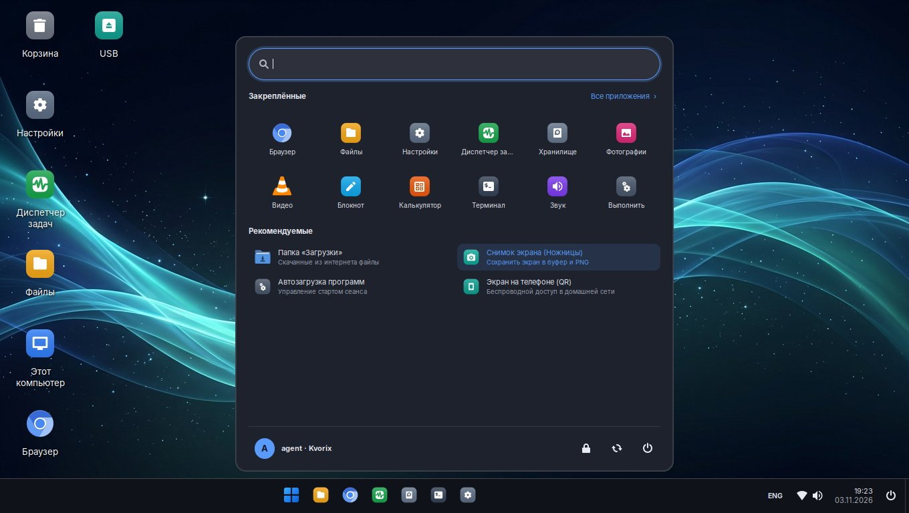
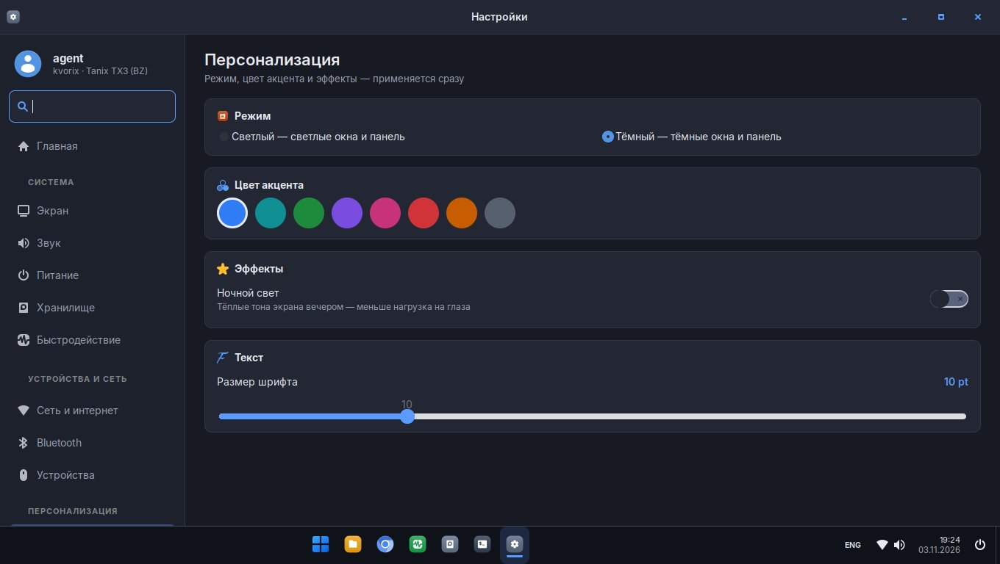

<div align="center">

# Kvorix

[Русский](README.md) · [English](README.en.md) · **中文**

**把 Tanix TX3 电视盒（Amlogic S905X3）变成一台流畅的桌面电脑**

Armbian（Debian 13 "trixie"）· ophub 6.12 内核 · Windows 11 风格的 XFCE 桌面 · 自有的设置程序和图标

[](LICENSE)


</div>

## 简介

Kvorix 把便宜的 **Tanix TX3** 安卓盒子变成安静的家用电脑：浏览器、文件、视频、打印、手机投屏、
绕过网络封锁——无需命令行即可使用。

- **Windows 11 风格界面：**居中的任务栏，带搜索和固定程序的"开始"菜单，
  Win+E / Win+I / Win+R / Win+P / Win+V / Ctrl+Shift+Esc 快捷键，窗口贴边。
- **屏幕键盘**（Win+Ctrl+O），可用鼠标或遥控器输入。
- **全系统统一的图标风格**；新安装的程序会自动获得同风格图标。
- **自有的"设置"程序**，布局类似 Windows 11，可搜索所有选项。
- **无 HPD 的显示器识别：**TX3 无法检测 HDMI 热插拔，系统通过 DDC 读取 EDID，自动设置原生分辨率和 HDMI 音频，
  并提供适配电视过扫描的模式。
- **前面板 88:88 时钟**（FD6551）：时间、日期、温度、负载。
- **扫码投屏到手机**（noVNC，仅限家庭网络）。
- **zapret 防 DPI** 与 **Tailscale**。
- **性能：**CPU 最高 2.1 GHz、zram、Panfrost GPU、Chromium 硬件加速绘制。
- **自我修复：**网络与服务看门狗、Tailscale 自动恢复、`kvorix-health-check`。

| 开始菜单 | 设置 |
|---|---|
|  |  |

## 安装

1. 将适用于 S905X3 的 **ophub Armbian** 镜像（Debian trixie，内核 6.12）写入 SD 卡或 U 盘并从其启动：
   [ophub/amlogic-s9xxx-armbian](https://github.com/ophub/amlogic-s9xxx-armbian/releases)。
2. 首次设置时创建用户 **`agent`**。
3. 安装 Kvorix：

```bash
git clone https://github.com/NineUPFLOW/kvorix.git
cd kvorix
sudo ./install.sh
sudo reboot
```

`install.sh` 会安装 `packages.txt` 中的软件包，把 `rootfs/` 复制到 `/`，启用 Kvorix 服务，并为本机生成独立的
SSH 密钥、VNC 密码和 noVNC 令牌。如需为自己的盒子制作镜像，请参阅 [docs/BUILD.md](docs/BUILD.md)（俄语）。

## 硬件

已在 **Tanix TX3 (BZ)** 上测试：Amlogic S905X3（4× Cortex-A55）、2 GB 内存、16 GB eMMC、Broadcom BCM4330 Wi-Fi/蓝牙、
FD6551 前面板，设备树 `meson-sm1-tx3-bz.dtb`。其他 S905X3 盒子更换 dtb 后也可能可用。

## 文档

详细文档（俄语）位于 [`docs/`](docs)：安装、构建、功能、架构、硬件、故障排除，以及 [SECURITY.md](SECURITY.md)
和 [CHANGELOG.md](CHANGELOG.md)。

## 许可证

Kvorix — © 2026 **NineUPFLOW**，采用 [GNU GPL v3.0](LICENSE) 许可：可以使用、学习、修改和分发，但须保留作者署名并使用
相同许可证。第三方组件遵循各自的许可证，见 [THIRD_PARTY.md](THIRD_PARTY.md)。
